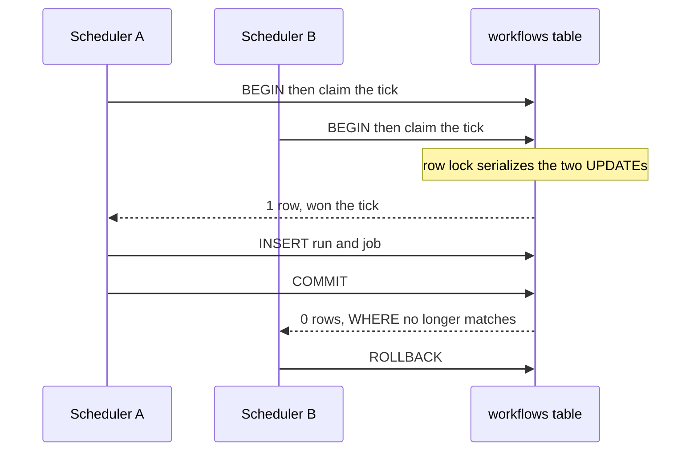

# 09. One tick, one run

*Scheduler concurrency and duplicate prevention. Entry tag: `learn-09`.*

## The idea

The scheduler wakes every 10 seconds, finds cron workflows whose `next_run_at` has passed, and schedules a run for each. The old code did this in three separate steps: SELECT the due workflows, schedule the run, UPDATE `next_run_at`. Between the SELECT and the UPDATE there was a gap, and in that gap lived a duplicate. Two scheduler processes, one slow scheduler whose ticks overlap, or a restart at the wrong moment, and the same tick got two runs. The code even admitted it in a comment.

The fix is one transaction and one conditional UPDATE. For each due workflow, the scheduler opens a transaction and runs:

```sql
UPDATE workflows SET next_run_at = <next cron time>
WHERE id = <workflow> AND (next_run_at IS NULL OR next_run_at <= now())
RETURNING id
```

Only if a row comes back did this scheduler win the tick; then it creates the run and its job in the same transaction and commits. If no row comes back, someone else won, and it rolls back and walks away.

Why does the loser get zero rows instead of its own copy? The row lock. Both UPDATEs want the same workflow row, so Postgres serializes them. The winner updates `next_run_at` to a future time. The loser waits, then, under READ COMMITTED, re-checks its WHERE clause against the winner's committed row: `next_run_at <= now()` is no longer true, so it updates nothing. Exactly one winner per tick, no matter how many schedulers race. This is the same row-locking idea from the job queue (entry 04), turned inward on the scheduler itself.

Putting the claim and the run creation in ONE transaction closes the crash gap too. If the scheduler dies between winning the tick and creating the run, everything rolls back and the tick stays due: the next sweep retries it. The old order, schedule first and advance `next_run_at` after, could skip a tick forever on a crash; the new order cannot.

Three smaller decisions ride along:

**No leader election.** The reaper (entry 07) uses an advisory lock to elect a single sweeper. The scheduler deliberately does not. The conditional UPDATE already makes a losing scheduler's work a harmless rollback, so a lock would buy nothing but failover delay: with no lock, if a scheduler dies, the others are already ticking. Correctness comes from the gate, not the lock.

**Missed ticks do not backfill.** If the scheduler was down for six hours on an hourly cron, the next sweep schedules ONE run and advances `next_run_at` to the next cron time from now. No thundering backlog of six runs. One catch-up run, then back on schedule.

**One bad workflow cannot kill the tick.** A broken cron expression used to throw inside the loop and abort the whole sweep. Now each workflow is isolated: a bad expression is logged and skipped, and the tick continues with the rest.

## The diagram



The shape to notice: the loser does not get an error, a retry, or a stale copy. It gets zero rows, which is the database's polite way of saying "already handled."

## Try it yourself

This entry's tag is `learn-09`. You need the local stack running.

**Do.** Check out the tag, start Postgres, migrate, and seed:

```
git checkout learn-09
docker compose -f infra/compose.yaml up -d
npm install
cp .env.example .env
npm run db:migrate
npm run db:seed
```

**Do.** Make the heartbeat workflow due, then open two database sessions. In session 1:

```
BEGIN;
UPDATE workflows SET next_run_at = now() + interval '1 minute'
WHERE id = '22222222-2222-2222-2222-222222222222'
  AND (next_run_at IS NULL OR next_run_at <= now())
RETURNING id;
```

**Do.** In session 2, run the same UPDATE. Watch it hang: it is waiting on session 1's row lock.

**See.** Back in session 1, `COMMIT;`. Session 2 immediately returns zero rows. That is the whole mechanism: the loser re-checks the WHERE against the winner's committed row and stands down. One tick, one winner, no application-level locking.

**Do.** Now the real thing. Set the heartbeat due again and start two schedulers:

```
UPDATE workflows SET next_run_at = now() - interval '1 second'
WHERE id = '22222222-2222-2222-2222-222222222222';
npm run dev:scheduler & npm run dev:scheduler &
```

**See.** Both log their ticks, but only one logs `run ... for "heartbeat"`. Then check:

```
SELECT count(*) FROM workflow_runs WHERE workflow_id = '22222222-2222-2222-2222-222222222222';
```

One run. Kill the schedulers when you are done.

**Break.** Set `next_run_at` to three hours ago and start one scheduler. Count the runs: one, not three. Missed ticks do not backfill. Then give a workflow a garbage cron expression (`UPDATE workflows SET definition = jsonb_set(definition, '{trigger,cron}', '"nope"')`) and watch the scheduler log the skip and keep scheduling everything else.

**Decide and defend.** Before reading the code: the reaper elects a leader with an advisory lock, but the scheduler does not. Argue both sides, then pick. When is a lock the right tool, and when is a conditional UPDATE enough? (Then read `tryScheduleTick` in `src/scheduler/index.ts`.)

**Clean up.** `docker compose -f infra/compose.yaml down`.

## What we actually did

- `src/lib/executor.ts`: `scheduleRun` accepts an optional database client. Pass one and it joins the caller's transaction instead of managing its own; the caller then owns COMMIT, ROLLBACK, and the bell. The API's call is unchanged (no client, same behavior as before).
- `src/scheduler/index.ts`: new `tryScheduleTick` claims the tick and schedules the run in one transaction, with per-workflow error isolation (a bad cron expression is logged and skipped, never aborts the sweep). `main()` is guarded so the module can be imported by tests without starting the loop.
- `docs/architecture.md`: ADR-007 records the decision.
- Verified against real Postgres 16 with 17 checks: two concurrent claims at the SQL level yield exactly one winner; two real scheduler processes racing yield exactly one run and one job; a mid-transaction failure rolls back the claim (tick stays due, nothing orphaned); three hours of missed ticks produce one run with `next_run_at` at the next cron time; a fresh workflow (`next_run_at` NULL) raced by two callers fires exactly once; a bad cron expression is skipped while its neighbors still schedule. Browse it at the [`learn-09`](https://github.com/VaidikV/conduit/tree/learn-09) tag.

Deliberately not built yet: the polling fallback for missed notifications, the last item in phase 2. Note this entry motivates it from a new angle: the scheduler rings the bell after commit, and if that notify is ever lost, an idle worker sleeps through a freshly scheduled run.

## Check your understanding

1. Two schedulers race one tick. Scheduler A wins the UPDATE, then crashes before COMMIT. What does scheduler B's UPDATE return, how many runs result, and what happens on the next sweep?
2. Why does the loser get zero rows instead of blocking forever or getting a stale copy? Name the two Postgres behaviors doing the work.
3. The scheduler was down for six hours on an hourly cron. How many runs fire when it returns? Argue for and against backfilling the missed five.
4. A workflow has a cron trigger but the expression is missing or garbage. What happens on every tick, and why does nothing else break?
5. **Supervise the machine.** Ask an AI how Conduit keeps two schedulers from scheduling the same tick twice. Find what its answer gets wrong or leaves out. (Ours: the conditional UPDATE on `next_run_at` inside the same transaction as the run and job inserts; the loser gets zero rows via the row lock plus READ COMMITTED re-check; no leader lock, because the gate already makes losing harmless; missed ticks do not backfill.)
