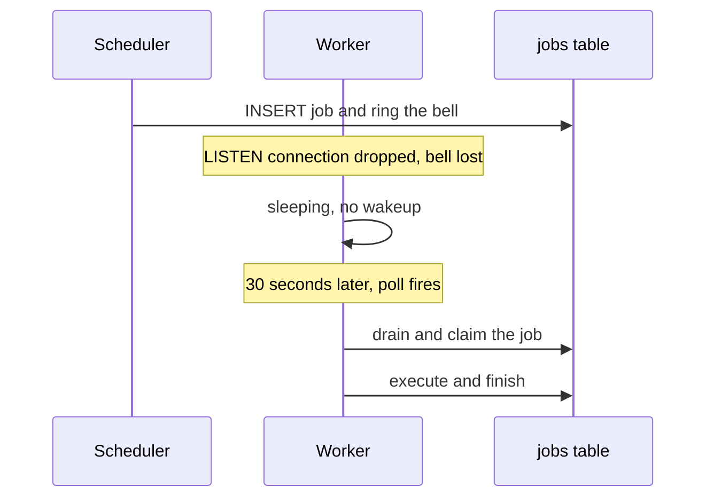

# 10. When the bell never rings

*Polling fallback for missed notifications. Entry tag: `learn-10`.*

## The idea

Every wakeup in Conduit is a bell: `pg_notify` fires when a job is enqueued, requeued, replayed, or scheduled, and idle workers LISTEN for it. Bells are fast, but they are fire-and-forget. Postgres delivers a notification only to sessions that are listening *at that exact moment*. If the worker's LISTEN connection drops, a network blip, a database restart, the error handler just logs it, and every bell after that is silently lost. The worker sleeps. Queued jobs pile up. Nothing in the system notices, because the system assumed the bell would be heard.

The fallback is deliberately boring: every 30 seconds, each worker drains the queue directly, bell or no bell. A missed notification now delays pickup by at most one poll interval instead of stalling forever. And because the poll does not depend on the LISTEN connection at all, a permanently dead listener heals itself with no reconnect logic: the worker keeps finding work on its own.

A few things this is not. It is not a replacement for bells: the hot path still wakes in milliseconds, and the poll only bounds the worst case. It is not piggybacked on the reaper sweep even though both run every 30 seconds, because the reaper elects a single active sweeper with an advisory lock while the poll must run on *every* worker: if only the elected reaper polled and that worker died, the fallback would die with it. And it needs no new concurrency control: the `draining` flag already makes a poll that lands mid-drain, or races a bell, a harmless no-op, and the in-flight drain's loop-until-empty covers the new job. `claimJob`'s atomicity remains the real guarantee against double execution.

The whole change is a constant and a timer. That is the point worth sitting with: the previous nine entries built precise machinery, bells, leases, ledgers, gates, and this entry admits that every one of those assumes the network cooperates. The poll is the system distrusting its own assumptions on a schedule.

## The diagram



The shape to notice: nothing in the diagram is new except the poll. The recovery uses the exact same drain path as the happy path, which is why it needed no new correctness argument.

## Try it yourself

This entry's tag is `learn-10`. You need the local stack running.

**Do.** Check out the tag, start Postgres, migrate, and seed:

```
git checkout learn-10
docker compose -f infra/compose.yaml up -d
npm install
cp .env.example .env
npm run db:migrate
npm run db:seed
npm run dev:worker
```

**Do.** Wait for the worker to go idle, then enqueue a job the hard way, with SQL and no bell:

```
INSERT INTO workflow_runs (workflow_id, trigger)
VALUES ('11111111-1111-1111-1111-111111111111', 'manual') RETURNING id;
```

Take the returned id and insert the job, swapping in your run id:

```
INSERT INTO jobs (queue, kind, payload) VALUES ('default', 'workflow_run',
'{"runId": "<run-id>", "workflowId": "11111111-1111-1111-1111-111111111111",
  "workflowName": "hello", "trigger": "manual", "input": {}}');
```

**See.** Nothing happens. Watch the worker logs: silence. The bell was never rung, so as far as the worker knows, there is no work. Now watch the jobs table:

```
SELECT status FROM jobs ORDER BY created_at DESC LIMIT 1;
```

Run it every few seconds. At roughly the 30-second mark the poll fires, the worker claims the job, and the status flips to `succeeded`. That silence-then-pickup is the fallback working: the worst case after a missed bell is one interval.

**Do.** Now enqueue the normal way and compare:

```
curl -s -X POST localhost:3000/workflows/11111111-1111-1111-1111-111111111111/run
```

**See.** The worker picks it up within a second or two. Bells still drive the hot path; the poll is only the safety net.

**Break.** Enqueue another silent job, then watch the timing closely: note the exact second you insert it and the exact second the status flips. The gap tells you where the worker is in its 30-second poll cycle. Then argue the tradeoff: what would you gain and lose by polling every 5 seconds instead?

**Decide and defend.** Before reading the code: the reaper already sweeps every 30 seconds. Why does the poll get its own timer instead of riding along on the reaper sweep? (Then read `main()` in `src/worker/index.ts` and the `POLL_INTERVAL_MS` comment in `src/lib/queue.ts`.)

**Clean up.** `docker compose -f infra/compose.yaml down`.

## What we actually did

- `src/lib/queue.ts`: `POLL_INTERVAL_MS = 30_000`, sharing the reaper's cadence, with a comment explaining the missed-bell scenarios it covers.
- `src/worker/index.ts`: a `setInterval` that calls `drain()` every poll interval. The existing `draining` guard makes overlapping or racing drains safe; no other changes were needed.
- `docs/architecture.md`: ADR-008 records the decision.
- Verified against real Postgres 16 with 7 checks: a job enqueued with no bell sits queued (proving no hidden wakeup path) and is picked up at poll-scale time, succeeding with a single delivery; the bell path still picks up in seconds; and a bell-driven run observed past a poll tick executes its step exactly once. Browse it at the [`learn-10`](https://github.com/VaidikV/conduit/tree/learn-10) tag.

Phase 2 is now complete: seven decisions, from at-least-once execution to this fallback, each verified against real Postgres with real process behavior. The engine delivers every job at least once, retries intelligently, survives worker crashes, reaps the dead, replays on human judgment, schedules exactly once per tick, and now wakes up even when nobody rings the bell.

## Check your understanding

1. The worker's LISTEN connection drops at 10:00:00. A job is enqueued at 10:00:05 and its bell is lost. By when at the latest is the job picked up, and which mechanism picks it up?
2. A bell and a poll tick arrive at the same instant for one queued job. Walk through what happens, and name the two mechanisms that prevent double execution.
3. Why doesn't the 30-second poll make bells redundant? What would you lose by deleting the LISTEN path entirely?
4. The elected reaper worker dies. Does the polling fallback keep working? Why is that the reason the poll is not piggybacked on the reaper sweep?
5. **Supervise the machine.** Ask an AI what happens in Conduit when a `pg_notify` bell is lost. Find what its answer gets wrong or leaves out. (Ours: every worker polls the queue every 30 seconds, so the worst case is one interval of delay; this also heals a permanently dead LISTEN connection with no reconnect logic; the hot path still runs on bells.)
